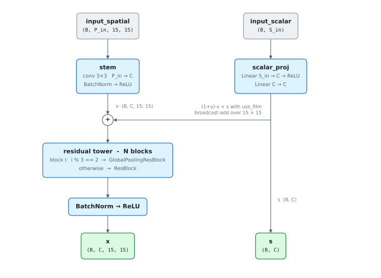
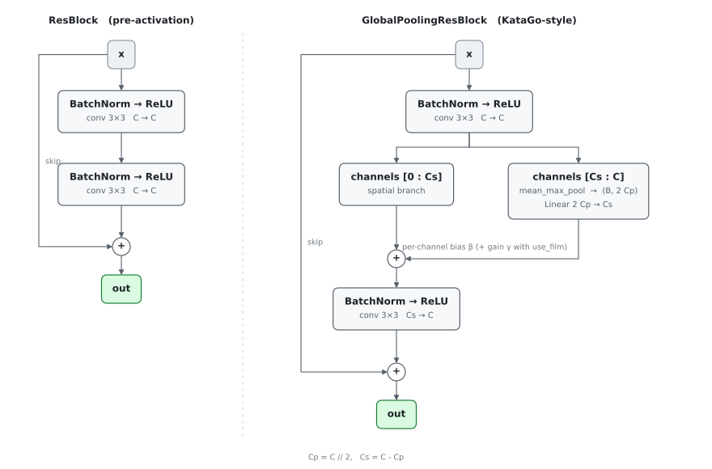
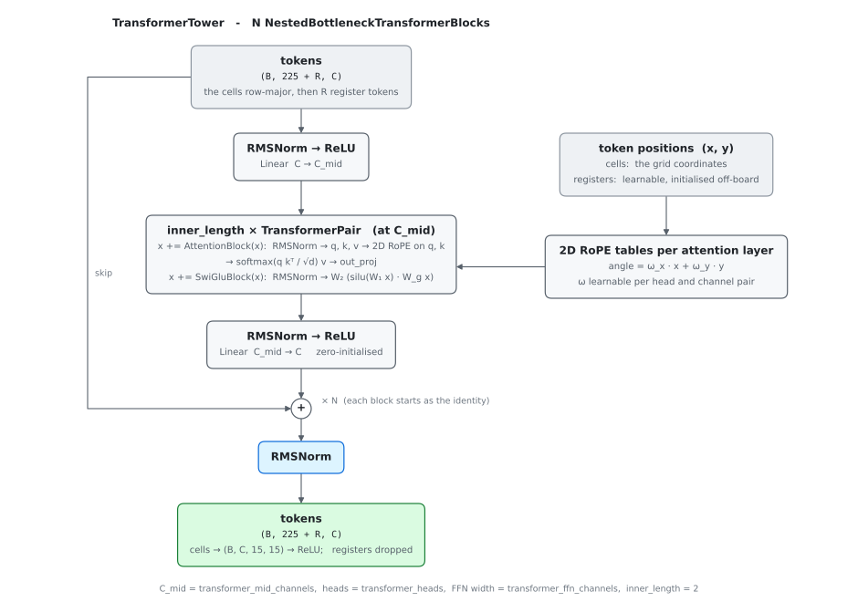
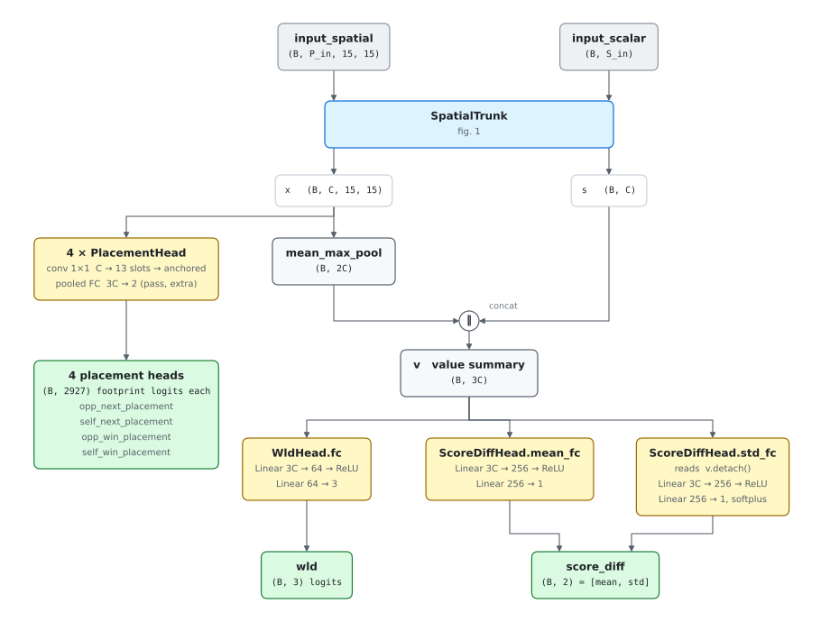

# Model architectures

Wiring diagrams and loss tables for the position evaluation network and the
spatial trunk the trained networks share, for anyone reading or changing the
model code. What the models are *for* is in [roadmap.md](roadmap.md).
Authoritative code:
[spatial_trunk.py](../py/scribblez/spatial_trunk.py),
[position_eval/model.py](../py/scribblez/position_eval/model.py).

> **Keep in sync.** An architecture change in either file belongs in the
> same commit as the matching change here. The figures are generated: edit
> [py/tools/plot_model_architectures.py](../py/tools/plot_model_architectures.py)
> and re-run it, never the SVGs.

Symbols used throughout:

| Symbol | Meaning | Default |
|--------|---------|---------|
| `C` | `trunk_channels` | 192 |
| `N` | `num_blocks` in the tower | 10 |
| `C_mid` | `transformer_mid_channels`, the width inside a transformer-tower block | 192 |
| `R` | register tokens appended to the transformer tower's cell sequence (the 27 tile-supply tokens) | 27 |
| `P_in` / `S_in` | spatial planes / scalar width of the board input | 87 / 136; 87 / 163 under the open-leaves arm |
| `B` | batch of board positions | — |
| `‖` | concatenate along the channel/feature dim | — |

A **footprint** recurs below: the squares a move newly covers, identified as
`(anchor, orientation, k)`, meaning the first `k ∈ 1..7` empty cells from the
anchor square along the play axis. There are 2927 footprint classes: 225
anchor cells × 13 slots (one orientation-free slot for `k = 1`, then
`k = 2..7` for each orientation), plus two catch-all classes (pass, and a
second whose meaning depends on the head). The class layout is owned by
[footprint.h](../engine/include/training/footprint.h).

---

## 1. Shared spatial trunk

`SpatialTrunk` also accepts an optional compiled-lexicon module, which injects a
per-cell residual after the stem. That experiment is deprecated and left out
of the diagram.

### FiLM conditioning (`use_film`)

By default every route from the scalar (board-global) features into the board
features is an **addition**: the stem injection (`x + s`) and each
global-pooling block's per-channel bias. Addition can only shift a cell's
features by a scalar-derived amount; it cannot gate one feature on another.
So the trunk cannot express "the opponent holds letter L, so attend to L's
cross-check plane". Measured consequence: the face-up-leaves model reads
cross-check masks through a fixed tile-frequency prior and ignores the
opponent's leave (probed on pre-footprint checkpoints by a since-removed script;
see [film_conditioning_results.md](film_conditioning_results.md)).

`use_film` adds the missing multiplicative half at both injection sites
([FiLM](https://arxiv.org/abs/1709.07871)): alongside the additive term `β`,
the scalars emit a per-channel gain `γ`, applied as `(1 + γ) · x + β`. The `γ`
projections are zero-initialised, so a FiLM trunk starts numerically identical
to the additive one and departs from it only as the multiplicative capacity
earns its way in. The scalar projection `s` returned to the heads is the `β`
half, unchanged.

`use_film` is off by default and wired only through `PositionEvalModel`; the
diagram shows the additive form. What it did and did not fix is in
[film_conditioning_results.md](film_conditioning_results.md).

### Tower blocks

`mean_max_pool`, used by both the pooling block and the value heads,
concatenates the channel-wise mean and max over the board:
`(B, C, H, W)` → `(B, 2C)`.

### Transformer tower (`trunk = transformer`)

The conv tower reasons spatially through stacked 3×3 convolutions and
re-broadcasts board-global context through its global-pooling blocks. The
transformer tower ([transformer_tower.py](../py/scribblez/transformer_tower.py))
replaces both, mirroring the trunk of KataGo's released transformer nets (its
`NestedBottleneckTransformerBlock`).

The stem is unchanged. After the scalar injection, the `15×15` feature map
becomes a sequence of 225 cell tokens. Each of the `N` blocks:

1. projects the trunk stream down to `C_mid` (`RMSNorm → ReLU → Linear`);
2. runs two (self-attention, SwiGLU FFN) pairs at that width, each on its own
   residual;
3. projects back up (`RMSNorm → ReLU → Linear`). This projection is
   zero-initialised, so every block starts as the identity on the trunk
   stream.

A final RMSNorm, the cells laid back onto the board, and a ReLU give the heads
the same `(B, C, 15, 15)` map the conv tower does. There are no global-pooling
blocks, since attention already sees the whole board.

Position enters through 2D rotary embeddings on the queries and keys. Each
channel pair of a head is rotated by `ω_x·x + ω_y·y` with per-head, per-pair
**learnable** frequencies, initialised log-uniform between one radian per cell
and one per fifty cells, so a head can become as local or as global as it
needs. The board has no off-board cells, so none of KataGo's off-board masking
is needed. With `transformer_qk_norm` (off by default), each head's queries
and keys are RMS-normalized before the rotation, which bounds the attention
logits by learned gains rather than by the projection weights.

The sequence may carry `R` **register tokens** after the cells: extra tokens
the model supplies, with learnable 2D positions initialised just off the
board's left edge, which every attention layer sees alongside the cells.
`PositionEvalModel` fills them with the tile-supply tokens of §2.

`trunk_channels` and `num_blocks` keep their meaning (`C` and `N`);
`transformer_mid_channels`, `transformer_heads` and `transformer_ffn_channels`
size the inside of a block. `PositionEvalModel` selects the tower with its
workload's `trunk` param, and the `transformer` and `conv` parameter profiles
pick an arm together with its recipe (the transformer profile adds
`grad_clip = 1` and turns activation checkpointing off).

---

## 2. `PositionEvalModel`

One board in, six heads out. `wld` is the inference head; the rest are
auxiliary training signal.

`ScoreDiffHead.std_fc` reads a **detached** `v`, so the std loss trains that
stack alone, never the trunk or the mean.

### Placement heads

The four placement heads are **categorical distributions over footprints**.
Each is a `PlacementHead`: a `Conv2d(C → 13)` whose `(cell, slot)` flattening
is exactly `training_targets.h`'s anchored-class index, plus a pooled FC for
the two catch-all classes, giving `(B, 2927)` raw logits.

- The plays heads (`*_next_placement`) distribute over footprints ∪ {pass}:
  where that seat's next move lands. Their second catch-all is an unused
  dummy.
- The win heads (`*_win_placement`) distribute over
  {footprint ∧ that seat wins} ∪ {not-win}. Summed over the footprints
  covering a cell, this is `Pr[covers cell ∧ that seat wins]`.

Training is **masked softmax cross-entropy** against the footprint class. The
engine computes a legality mask per row on replay: a sound over-approximation,
near-exact for the opponent heads, and for the self heads invariant to the
opponent's intervening move. Illegal footprints go to −∞ before the softmax,
and the target class is always kept, so the loss is never `−log(0)`. A softmax
conserves probability mass across footprints; the obvious alternative, a
per-cell BCE mask, lets total mass drift and is dominated by easy negatives,
which is what left the per-cell heads with systematic magnitude errors on the
test positions.

The exported graph emits raw logits (`kIdentity`), and every consumer masks
and softmaxes for itself. Only the dashboard reduces a head to a per-cell `(15, 15)` marginal (summing
footprint probability over the covered cells), for the human occupancy view.

### Tile-supply register tokens (transformer trunk)

The placement heads need to gate a square's cross-check letters on whether
those tiles are actually available: in the bag, in the opponent's known leave,
or on the mover's own rack. The conv trunk learns this poorly. Cross-checks
are a per-square, per-letter **spatial** signal, availability is a global
per-letter **scalar**, and the two meet only through the trunk's per-channel
bias or FiLM injection. That composition is sample-expensive, so a conv model
gates common tiles on availability but falls back to a fixed frequency prior
for rare ones (for example, a ~0.17 hook belief for a letter with no copies
unseen).

Under the transformer trunk each of the 27 tiles becomes a register token
([supply_registers.py](../py/scribblez/supply_registers.py)): a learned
per-tile identity embedding plus a projection of that tile's per-seat
availability counts (the mover's rack; the unseen pool, decoded from its
thermometer encoding; and under the open-leaves arm, the opponent's known
leave). A square that hooks on S or Y then reads S and Y supply directly in
every attention layer, graded by the actual counts and distinguishing
"available to me" from "available to the opponent", which a single gated
input plane cannot.

### Losses

| Head | Target | Loss | Weight (workload default) |
|------|--------|------|--------|
| `wld` | one-hot win/draw/loss | cross-entropy | `lambda_wld` = 1 |
| `score_diff[:,0]` | observed final differential | Huber (δ=10) | `lambda_sd` = 0.0002 |
| `score_diff[:,1]` | `MAD_TO_STD · \|mean − target\|`, detached | Huber (δ=10) | `lambda_sd` = 0.0002 |
| `*_next_placement` | footprint class index (+ legality mask) | masked softmax-CE | `lambda_next_placement` = 0.5 each |
| `*_win_placement` | footprint class index (+ legality mask) | masked softmax-CE | `lambda_win_placement` = 0.5 each |

`MAD_TO_STD = sqrt(π/2)` rescales the absolute-residual target so its optimum
is a Gaussian σ.

The model's recipe carries no penalty on activation magnitude. It is served
in BF16, which has FP32's exponent range, so the trunk's activations
may grow without risk of overflow
([fp16_safe_serving.md](plans/fp16_safe_serving.md)).
