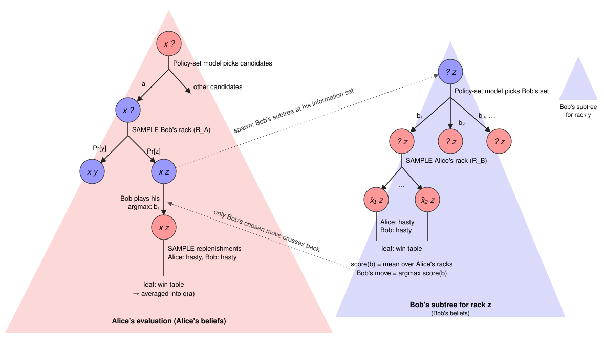

# DeepBot: many-tree information-set search with regression transfer

**Status: proposed 2026-10-12, rewritten 2026-10-13 around many-tree
information-set search; plan-reviewed twice ([review record](#review-record));
not built, and not yet placed in the [roadmap](../roadmap.md).** DeepBot
plays standard Scrabble, with hidden leaves, from its first milestone. This
document is a design to guide development: its measurements inform the next
step, and no pass or kill thresholds are fixed in advance.

**Goal.** A search that does what a strong player does at
[Richards–Johnson](../analysis/richards-johnson-exchange/README.md):

- It reasons about a reply *kind* across many possible opponent racks at once,
  such as "Mike sets up a second S lane with YE\_\_".
- It carries what it learned about one candidate over to the others.
- It revisits a candidate when a later finding changes how its earlier search
  should be read.

Every decision must be made on what its player can see, never on the other
player's hidden tiles.

**Decision.**

- **Framework: many-tree information-set search** (MT-ISMCTS; Cowling, Powley
  & Whitehouse, 2015). Each player's decisions are evaluated over that
  player's own beliefs. Only chosen moves pass between players' searches;
  each player's values stay with that player.
- **Backup:** Gumbel MuZero's completed values and improved policy, with a
  per-action posterior in place of visit counts. Values are recomputed from
  current estimates, never accumulated.
- **Transfer:** a per-turn **Bayesian linear regression** for each player
  whose decisions are searched. It predicts how far evaluation moves a value
  from the network's prior, from features the network computes for every
  move. It sets the estimate and uncertainty of every action not yet refined,
  and refinement overrides it.
- **v1 is the flat form of this framework, a response table.** One decision
  each: ours at the root, and the opponent's reply. The reply is evaluated
  over the opponent's beliefs, and transfer runs across the opponent's racks.
  General trees, deeper decisions and the second regression come in E2, if
  v1's failures call for depth.
- **Training:** the features are meta-learned offline (a closed-form ridge
  over logged residuals), so that the regression works.

## Purpose

[simulation_information_flow.md](../simulation_information_flow.md) walks an
idealized agent through Richards–Johnson and names what it does:

- **Sideways valuation:** one ETS rack's result prices a quarter of the rack
  space.
- **Sideways steering:** ALLEE's probes change which reply Mike tries after
  other candidates.
- **Revision:** later probes re-price earlier ones.

It also shows why plain node statistics cannot carry those flows in Scrabble:
below the first draw, most nodes are visited once. In a many-tree search that
problem has a precise location. There is one opponent search per sampled
opponent rack, and each is visited rarely. Sharing what one rack's search
learns with the others is the transfer's whole job, and v1 does exactly that
job.

The learned part is small: a feature map trained offline, plus a regression
fitted per decision. Aggregation, weighting by evidence and shrinkage are
classical statistics, not something a network has to learn.

## Where this sits

- **[sim_residual_feedback.md](sim_residual_feedback.md)** supplies two
  principles DeepBot keeps:
  - residuals are measured against the prior's prediction for the *same*
    state;
  - candidates are allocated by expected gain over the best so far.

  It also supplies the root shortlist. Its two shortcomings motivate this
  plan:
  - hasty rollouts never play the reply that matters;
  - a key move may not be illuminated by its siblings' sims.

  DeepBot evaluates the opponent's replies over the opponent's own beliefs,
  and gives every candidate value from its own evaluations.
- **Standard Scrabble from the start.** Hidden racks are where the framework
  applies, so DeepBot does not pass through face-up leaves. Every trained
  checkpoint is face-up today, so it uses the face-up prior as a bridge
  ([The prior](#the-prior-in-standard-scrabble)).
- **[Q-Dispersion Tree Search](https://github.com/shindavid/AlphaZeroArcade/blob/main/docs/Q-Dispersion-Tree-Search.md)**
  adds AlphaZero mechanics and a defense against policy collapse to
  MT-ISMCTS. DeepBot's per-action posterior plays a role like QDTS's utility
  dispersion ([The opponent model](#the-opponent-model)).
- **The pending shared turn-sim core** (a follow-up from the sequential-agent
  work) is the natural home for DeepBot's evaluation loop. DeepBot should not
  become a fifth copy of turn simulation.

In the flow vocabulary, v1's profile:

| root steering | steering below root | chance steering | action valuation | chance valuation | revision |
|---|---|---|---|---|---|
| sideways | sideways (the opponent's reply) | fixed (seeded samples) | sideways | sideways | yes |

### Reuse

| Component | Role in DeepBot |
|---|---|
| `MoveProposalService` / `MoveSetEvalService` ([agent/](../../engine/include/agent/), [nn/](../../engine/include/nn/)) | root shortlist; per-move priors `v̂`; the hidden state `h(a)` after a new aux output ([Features](#features-and-their-training)) |
| `EquityLikelihood` / `RackInferrer` ([belief/](../../engine/include/belief/)) | both beliefs; the B-side posterior is factorized ([Beliefs](#beliefs)) |
| `CrossCheckEncoder` inputs ([training/cross_check_delta.h](../../engine/include/training/cross_check_delta.h)) | the mechanical features |
| `EndgameSolver` ([endgame/endgame_solver.h](../../engine/include/endgame/endgame_solver.h)) | evaluations once the bag is empty |
| BestBot, `mset-sim` | match baselines |

Not used: `PreEndgameSolver`, which aggregates over bag draws with its own
pessimistic rule, and `Bag`'s private RNG draw, which a seeded draw sequence
replaces ([Seeds](#seeds)).

## The framework

Write **A** for the player to move at the root (Nigel) and **B** for the
opponent (Mike).

- **A's search** is rooted at A's information set: the public history plus
  A's rack. It samples what A cannot see (B's rack, A's coming draws) from
  A's beliefs.
- **B's searches**, one per sampled B rack `r_B`, are rooted at B's
  information set after A's move. They sample what B cannot see (A's leave,
  A's draw) from B's beliefs.
- **Only chosen moves cross.** A's search asks B's search for B's policy at
  `r_B`, and B's valuations stay in B's search. B's values are computed over
  B's beliefs, which differ from A's.

*Tree spawning, after Cowling et al. (2015). Each triangle is one player's
search, colored by whose beliefs it runs on: red for Nigel's, blue for
Mike's. Each node is colored by whose turn it is, and labeled with Nigel's
tiles, then Mike's, with `?` for tiles unknown to the tree's owner. Nigel's
tree starts at `x ?`: he holds `x` (AEELLNT) and cannot see Mike's rack. He
plays ALLEE, then samples Mike's rack from his own belief (`y` or `z`). At
`x z` it is Mike's turn, and Nigel cannot choose Mike's move with Nigel's own
values, so he **spawns** Mike's tree rooted at `? z`: Mike holds `z`, an ETS
rack, and does not know Nigel's tiles. In that tree Mike tries 8K YEET, YENS,
a bingo and the rest; samples Nigel's leave and draw from Mike's belief (which
reads what ALLEE reveals), giving `x̂ z`; lets Nigel reply from his prior; and
evaluates. **Only the move crosses back:** YEET, sampled from Mike's policy
`π′`, becomes an edge in Nigel's tree, where Nigel samples his own draw and
evaluates on his own beliefs. Mike's values never enter Nigel's tree. Each
sampled rack gets its own Mike tree (`y` at right). What one of them learns
reaches the others through the shared regression `w_B`, which is how one
YEET discovery informs every ETS rack. The dashed tree, Nigel as Mike imagines
him, would come from spawning one level deeper. v1 uses Nigel's prior there
instead.*

In general, each search is a tree whose decision nodes are keyed by their
player's information set. Searches spawn further searches wherever the other
player decides. v1 cuts this at one decision per player, which makes the trees
flat: a table.

## v1: the response table

**Rows.** For each root candidate `a`, each sampled `r_B`, and each legal B
reply `b`, there is a row `(a, r_B, b)` with two values:

- **`Q_B(a, r_B, b)`:** B's value of `b`, over B's belief about A's leave and
  draw. B chooses on this.
- **`Q_A(a, r_B, b)`:** A's value of the same continuation, over A's belief
  given `r_B`. A is valued on this.

**Decisions.**

- **B's policy at `(a, r_B)`** is `π′_B`, computed from the `Q_B` estimates
  of all B's replies. That is B's choice on B's information.
- **A's value of `a`** is `q(a) = Σ_{r_B} H(r_B) Σ_b π′_B(b | a, r_B) · Q_A(a, r_B, b)`,
  where `H` is A's posterior over B's rack. The root picks on `q(a)`, on A's
  information.

No decision is made inside a sampled world. The only decisions are B's choice
per `(a, r_B)` and A's choice at the root, and each averages over what its
player cannot see.

**Evaluations.** Refining a row means evaluating its value more precisely.
Both `Q_B` and `Q_A` are evaluated at the position after `b`:

- **If the bag is empty,** each player's sampled world is a perfect-information
  endgame, and the endgame solver gives the value
  ([Evaluations](#evaluations)).
- **Otherwise,** the network's value after `b`, from the relevant player's
  side, in each sampled world.

The value of a row is the weighted mean over its player's samples, and it
sharpens as more samples are drawn. Rows not yet evaluated use the prior plus
transfer ([Values](#values)).

**A's side of each row.** `π′_B` spreads over hundreds of replies, and only a
few carry most of its mass. `Q_A` is evaluated for B's top `m` replies by
`π′_B`. The tail is approximated by `1 − Q_B`, B's own value flipped, and
carries its own `τ²` band. Those tail values come from the wrong player's
information, so they are flagged and never enter a regression fit.

## Beliefs

**A's belief about B's rack, `H`:** B's leave from `RackInferrer` applied to
B's last move, plus a refill drawn uniformly from the rest of A's unseen
pool. It is computed once per turn.

**B's belief about A's leave, given `a` and `r_B`.** B infers A's leave from
the very move being evaluated, so a fishing play can look different to B than
to A. A single tree cannot express that.

Naively this is one `RackInferrer::infer` per `(a, r_B)`: 20 candidates × 200
racks = 4,000 inferences, at up to a few hundred milliseconds each. It
factorizes instead:

- **The likelihood** `P(a | leave)` (`EquityLikelihood`) depends on the board
  and the hypothesis, not on the pool. It is scored once per candidate, over
  every leave that any sampled `r_B` allows.
- **The prior over leaves** (hypergeometric from B's unseen pool) depends on
  `r_B`, and is cheap combinatorics.

So a candidate costs one likelihood pass, and each rack costs a reweighting.
This needs a small `RackInferrer` API split. `EquityLikelihood` models A as a
HastyBot-equity softmax. That is a weak model of an expert's choice, and a
known v1 limitation.

`RackInferrer` conditions on one move only. The Richards analysis's read that
"the C is in the bag" uses two (ZONES and WOE); extending the inferrer is
separate work.

### Seeds

Samples use variates keyed by `(sample index, draw ordinal)`.

- **B's racks** come from A's unseen pool, which does not depend on the
  candidate, so every candidate meets exactly the same `r_B`. This is the
  pairing that matters most.
- **Refills and B's split samples** map a variate to an index in a canonical
  sorted pool. Candidates whose pools coincide share draws exactly. Where the
  pools differ, because candidates play different tiles, the draws differ,
  and the pairing is approximate.

A `DrawSequence` interface (seeded, indexable) replaces `Bag::draw()` in
evaluation code.

## Evaluations

**The solver.** `EndgameSolver` in class mode (`spread_matters` off).

- A proven class gives a value of 1, 0.5 or 0, with near-zero variance.
- An unproven solve falls back to the network's value of the same position.
  With the bag empty, that position is fully known. The fallback carries the
  network's `τ²` for that band.

Solver instances are per thread, with a fresh transposition table per solve
in v1.

**The network** away from the endgame: the face-up move set prior, evaluated
in each sampled world with that world's opponent leave
([The prior](#the-prior-in-standard-scrabble)).

## Values

Each row's value, for each player, has an estimate `Q` and a variance `V`.

| row is | `Q` | `V` |
|---|---|---|
| evaluated | the weighted mean over the player's samples | sampling variance of the mean, plus per-sample variances |
| unevaluated (B's side) | `v̂(b) + c(b) + μᵀφ(b)`: prior, plus intercept, plus transferred correction | `φ(b)ᵀΣφ(b) + τ²(b)` |
| A's side, outside B's top `m` | `1 − Q_B` | `V_B + τ²_tail` |

`c(b)` is a per-band intercept, and `μ, Σ` the regression posterior
([Transfer](#transfer)). `τ²` is the prior's error variance
([Uncertainty](#uncertainty)).

**The improved policy.** `π′_B(b)` is the probability that `b` is B's best
reply, under independent Gaussians `N(Q_B(b), V_B(b))`. It is computed by
one-dimensional quadrature:

`∫ φ_b(x) Π_{b′≠b} Φ_{b′}(x) dx`

This is deterministic, so a recompute changes `π′` only when the estimates
change, and it costs `O(replies × grid)`. `π′` sharpens toward the best reply
as variances shrink, and stays spread over every reply that could still be
best while they are wide. Gumbel MuZero's visit-count `σ` (Danihelka et al.,
2022) would let effort spent on one reply lend confidence to the others'
guesses. It stays as an E2 ablation.

**Raw and corrected tracks.**

- **Raw:** unevaluated rows sit at `v̂ + c`, and `π′_B` is computed from those
  values (raw `π′`). Regression fits and distillation targets use this track
  only.
- **Corrected:** includes the transfer. The corrected `π′_B`, A's `q(a)`,
  allocation and the pick use this one.

Fitting on corrected values would let the regression confirm its own output.
Computing raw values with a corrected `π′_B` would do the same thing
indirectly. With transfer off, the tracks coincide.

**Recompute, never accumulate.** When the regression refits, every
unevaluated row's estimate changes, then every `π′_B`, then every `q(a)`.
Rows evaluated before a finding keep their values; `π′_B` decides their
weight anew. That is how the table revises itself.

## The opponent model

`π′_B` is B's policy, not an argmax. An argmax model of the opponent suffers
**policy collapse**: a small error in B's values flips B onto a single pure
move, and A best-responds to that artifact. `π′` built from posterior
uncertainty mixes among replies whose ranges overlap, which is the role
QDTS's utility dispersion plays. DeepBot's variances shrink as evaluation
accumulates, while QDTS keeps a floor from uncertainty about the rack model.
Scrabble has far less reason for mixed strategies than poker does, so v1
starts without a floor. A variance floor from the rack model's uncertainty is
the hook if collapse appears.

## Transfer

**One regression, `w_B`, shared across all of B's racks and all candidates in
the turn.** A's side has no decisions below the root in v1, so it has no
regression. `w_A` arrives with A-side search in E2.

**The model.** For each evaluated row, the residual is
`δ(b) = Q_B,raw(b) − v̂(b)`: how far evaluation moved B's value from the
prior, both computed over B's beliefs. Model it as
`δ(b) = c(b) + wᵀφ(b) + ε`:

- `c(b)` is an intercept per band of bag count, fitted without shrinkage, so
  `w` carries only what varies between replies.
- `w ~ N(0, λ⁻¹ I)`, with `λ` set by marginal likelihood.
- `ε ~ N(0, V_raw(b) + τ²(b))`.

The regression refits after every batch of `R` new evaluations (`R` ≈ 64 to
start).

**The Richards case.**

1. For one ETS rack under ALLEE, refining YEET finds it strong for Mike, a
   large residual. `w_B` moves along `φ(YEET)`.
2. For other racks, YETI and YEAN have nearby feature vectors. Their estimates
   rise before anything is evaluated there, so `π′_B` already leans toward
   the setup when A's value sums over those racks. YENS, the same footprint
   without the S hook, lies elsewhere in feature space and barely moves.
3. Under VELATE, which also plays five tiles, Mike's replies share those
   directions and inherit the correction. Under the exchange the bag-count
   feature differs, so they inherit less.

Discovery costs about one evaluation per reply *kind*, not one per rack.

**Transfer yields to evaluation.** Transfer only sets estimates for rows
nothing has evaluated. A wrong transfer costs efficiency, not correctness.

## Allocation

- **Which candidate:** expected gain over the incumbent,
  `E[max(0, q(a) − q(best))]`, with variances paired over the shared `r_B`.
- **The candidate set:** the move proposal shortlist plus a **timing floor**,
  the best candidate for each number of tiles played (0 through 7) and the
  top few exchanges. Transfer is weakest along the bag-count axis, so recall
  there cannot rely on it.
- **Which rows, within a candidate:** the B rows whose refinement could most
  change `q(a)`. A reply matters if it has `π′_B` mass now, or could gain mass
  (a wide variance near the top). Also, the A-side evaluations of B's top `m`
  replies.
- **The pick:** the highest corrected `q(a)` among candidates that reached a
  minimum share of the budget.

## The prior in standard Scrabble

Every move set and position checkpoint today is face-up: its input includes
the opponent's leave. A standard-Scrabble prior is a roadmap track not yet
started (new tags, not new code). Until it exists, DeepBot evaluates the
face-up prior **in each sampled world, with that world's opponent leave**, and
averages over the player's samples. Marginalizing over the belief is then just
the evaluation's own averaging, with no separate passes. The prior `v̂` for an
unevaluated row uses the posterior's modal leave: one pass, with the mismatch
absorbed into `τ²`.

This is a bridge. A face-up model was trained on games where both leaves were
public, so it values positions as if the rest of the game were played that
way. The intercepts and `τ²` absorb the average error. When the standard prior
is trained, it replaces the bridge.

## Features and their training

**The features.** `φ(b)` concatenates:

- `g(h(b))`, a projection of the move set model's per-move hidden state
  `h(b)`: the post-ReLU activation inside its value head, width `C` (192 in
  current models). No serving graph emits it today. Emitting it needs an aux
  output on `MoveSetEvaluationSpec`
  ([nn/model_specs.h](../../engine/include/nn/model_specs.h)), a re-export and
  parity coverage. It is read back in BF16.
- **Mechanical consequence features:**
  - the cross-check change summary: hooks created and destroyed, S hooks in
    particular;
  - tiles played, the bag count after the move, the score.

The mechanical features hedge against a blind spot in `h` itself.

**Width.** The search uses `d = 64`: a fixed PCA of `h`, fitted on a corpus,
plus the mechanical features. E0 compares PCA-64 with identity (`d ≈ 200`).

**Training `g`** is meta-learning with a closed-form base learner (R2D2,
Bertinetto et al., 2019):

1. **The corpus** is logged evaluations ([below](#the-log)).
2. **An episode is one logged turn.** Its rows split into support and query
   by `r_B`, so the query tests transfer across racks.
3. **The base learner** solves the ridge with intercepts on the support set
   in closed form, differentiable in `g`.
4. **The loss** is the Gaussian NLL of the query predictions, so `Σ` is
   calibrated as well as `μ`.
5. **The backbone** stays frozen, so `v̂` cannot drift while `g` learns.

**Selection bias.** Allocation picks rows the prior likes, while the
regression matters most for rows it ranks low. Corpus-generation runs (not
match play) therefore force exploration: a fixed fraction of evaluations go to
uniformly random or reverse-prior replies. Query error is reported stratified
by prior rank, with the bottom ranks as the headline.

**Controls:**

- *shuffled:* residuals permuted among a turn's rows;
- *mechanical only:* no `g`;
- *frozen `h`:* identity `g`.

Transfer is the query error with real residuals minus the error with shuffled
ones.

### The log

Minimal in E1 (moves, seeds, end-of-turn row values and effort, a backbone
fingerprint), and extended with forced exploration when E3 needs a corpus.
Following the replay-reconstruction invariant
([architecture.md](../architecture.md)), the trainer replays rows from moves
and seeds and recomputes `h` and the mechanical features. A replay test checks
the reproduction.

## Uncertainty

Three error models set the variances.

- **`τ²`, the prior's error,** per bag band. Its first fit comes from E0's own
  residuals: the modal-leave prior against truth over B's beliefs. The M1a
  near-endgame corpora (face-up, teacher at depth 0) serve only as a sanity
  bound.
- **`τ²_tail`** for A-side values approximated from B's, fitted from rows
  where both sides were evaluated.
- **The solver fallback,** which is the network's `τ²` for bag-empty
  positions.

These variances are the control surface. An overconfident `τ²` collapses `π′`
onto the prior's favorite, which is the very blind spot this plan targets.
Calibration (empirical coverage on held-out residuals) is checked at every
milestone.

## Residual space

Values are win equity, `P(win) + ½ P(draw)`, the project's ranking metric.
The move set model's WLD head collapses to it. Residuals and the Gaussian
model live in equity space in v1. E0 runs a logit arm (equity clipped to
[ε, 1 − ε]) as an alternative, and the search adopts whichever space E0 shows
predicts better.

## Improving the priors

Transfer corrects what is specific to a position; recurring patterns belong
in the weights. The priors lack setup patterns because their training data is
HastyBot-style play ([sim_labeled_candidates.md](sim_labeled_candidates.md)).

- **Student values** distill from raw evaluated values, never corrected ones.
- **The teacher** retrains on DeepBot self-play once DeepBot plays games,
  under the [generational lifecycle](../generational_training.md).
- **`g`** retrains on each generation's logs. As the priors improve,
  residuals shrink, and transfer covers a narrower remainder.

## Cost

Per turn, with `C` candidates, `K` sampled B racks, about `M` legal replies
per rack, and `S` samples per evaluated row:

| Item | Size |
|---|---|
| B-side move generation and prior | `C · K` positions: 20 × 200 = 4,000 trunk passes, `C·K·M` ≈ 2M reply rows |
| Belief inference | `C` likelihood passes, plus `C · K` cheap reweightings |
| Row evaluations | allocation-driven; each costs `S` network passes or solves |
| Transfer mean | `C·K·M · d` ≈ 128M multiply-adds per refit at `d` = 64 |
| Transfer variance | `C·K·M · d²` ≈ 8G multiply-adds per refit, a GPU batch |
| `π′` | `C · K · M · grid` per refit (quadrature) |
| `φ` storage | 2M × 64 × 2 bytes ≈ 0.26 GB in BF16 |

The move set service caps a row group at 4,096 moves, and batching across
positions follows the `BatchingPositionEvalService` pattern. E0.5 measures
the numbers that decide affordability.

## Build order

Each step names its PRs and its measurement.

**Prerequisite.** A named move set checkpoint that meets a maturity bar on
`eval_win_mae`, from the revised model now training after #346.

1. **E0-tool, the engine entry points (one PR).** A C++ tool or FFI for
   hypothetical states:
   - move generation from a given rack on a given board;
   - move set encoding with a given opponent leave;
   - the factorized `RackInferrer` (likelihood per candidate, prior per pool);
   - an endgame solve with explicit racks;
   - the `DrawSequence` mapping.

   These conventions carry into the search.
2. **E0, the offline transfer test.** It tests exactly `w_B`'s job.
   - *Positions:* Richards–Johnson after ALLEE and after VELATE. pos-09,
     egotize, the ACETA setup and a blind_spots sample are reported as a
     diagnostic regime.
   - *B's racks:* about 200, uniform over A's unseen pool, with `RackInferrer`
     on B's last move as a second arm.
   - *Truth for B's rows:* at Richards after a five-tile play, nine tiles are
     unseen to Mike. Their split into Nigel's rack and the bag (at most 36
     splits) is weighted by B's factorized belief. A reply of two or more
     tiles empties the bag, so each split is a solved endgame, proven
     verdicts only, and truth is the weighted mean. One-tile replies and
     passes are excluded and counted.
   - *Rows:* the prior's top 20, every YE\_\_ reply, and a random 10 from the
     rest, per rack. That is about 250k solves per position. A pilot (one
     position, 10 racks) measures solve time first, and E0 runs as a tag.
   - *Mid-game diagnostic regime:* truth from rollouts to the end with solved
     endgames, as in M1a's corpora. It is reported separately, because its
     truth is far noisier.
   - *Arms:* identity `g` against PCA-64; with and without mechanical
     features; equity against logit space; and a **noisy arm**, where truth
     is replaced by means over 2 to 4 sampled splits, matching E1's
     per-evaluation precision.
   - *A side measurement, the clairvoyance gap:* for each rack, Mike's best
     reply on expectation against his best reply per split. This prices the
     leak a per-world design would have.
   - *What E0 reports,* per regime and arm:
     - held-out R² of the residual, against the shuffled control;
     - for Richards, the predictions for held-out YE\_\_ S-hook replies after
       YE\_\_ has appeared in one or two racks, and the predictions for
       YENS-like replies;
     - calibration of the predictive variances.

     These readings decide what comes next: whether the regression transfer
     is worth building into a search, which feature arm and residual space
     to use, and whether the bridge prior is good enough.
3. **E0.5, the error models and throughput.**
   - Fit `τ²` and the intercept bands from E0's residuals; measure solver
     fallback rates.
   - Microbenchmark: B-side expansion (movegen, encoding, the move set pass,
     reading back `h`), the likelihood pass, solves per second, and one
     refit-plus-recompute at full table size.
   - *Informs E1:* how well the error models are calibrated, and how much of
     a match-time budget a turn needs.
4. **E1, the response table.** Separate PRs:
   1. Export `h` as an aux output (spec, re-export, parity test).
   2. The table, beliefs, evaluations, `π′`, allocation and the timing floor,
      with **transfer off**. Includes a **paired-world test**: change B's
      hidden split while holding B's observations fixed, and B's policy must
      not change. *Measure:* the Richards pick, the known positions, and
      matches against BestBot and `mset-sim` in standard Scrabble. This
      proves the substrate on its own.
   3. Transfer (the regression, intercepts, both tracks) and the minimal log.
      *Measure:* transfer on against off at equal time. Discovery cost is the
      number of evaluations until YE\_\_ replies carry their solved share of
      `π′_B` across racks.
5. **E2, trees.** General many-tree search: A-side decisions after B's reply,
   merged information-set nodes with Bayes weights, beliefs at deeper nodes,
   `w_A` (and with it the ALLEE-to-VELATE transfer on A's side), a second
   level of spawning, the per-tree perturbation and the Gumbel-`σ` ablation.
   Taken only if E1's failures trace to depth. E2 needs its own plan section;
   the review record lists what it must settle.
6. **E3, the learned projection.** Train `g` on logs with forced exploration,
   the controls and the rank stratification. Repeat E1's measurements.
7. **E4, the generational loop.** The standard-Scrabble prior replaces the
   bridge, student distillation from raw values, then DeepBot self-play for
   the teacher.

## Risks

- **Linear transfer may be too weak.** The fallback is a Gaussian process
  with a learned kernel, at `O(N³)` per fit.
- **The variances are the control surface.** Covered under
  [Uncertainty](#uncertainty), with calibration measured from E0.5 on.
- **The bridge prior.** If E0's residuals are dominated by the face-up
  mismatch, the standard prior moves onto the critical path.
- **A one-decision-per-player table** cannot see A's next move. Lines where
  A's reply after B's setup decides the game are valued by the network, not
  searched. E2 exists for that.
- **The table's breadth.** `C·K·M` rows is about 2M. If refits are too slow,
  `K` shrinks first, then the reply set per rack is truncated by `π′_B` mass.
- **Chance coverage.** A reply on no sampled rack is never evaluated, and at
  best is priced by transfer.

## Open questions

- **A better model of A's choice** inside B's belief than a HastyBot-equity
  softmax.
- **Rack inference over more than the last move,** for the two-move reads the
  Richards analysis makes.

## Review record

### Round 2, 2026-10-13, on the many-tree rewrite

Four panelists: hidden complexity, scope and integration as Claude
subagents, and the rival designer on Codex with repository access.

| Critique | Resolution |
|---|---|
| **Blocking.** B's belief about A's leave is one `RackInferrer::infer` per (candidate, `r_B`), because B's pool differs per rack: about 4,000 inferences at up to a few hundred milliseconds each, uncosted. | Revised. Factorized: the likelihood is scored once per candidate, the hypergeometric prior once per rack. Costed, and benchmarked in E0.5. |
| **Blocking.** No belief source below the two roots, with two incompatible answers for A's later nodes; in-tree weights would make `v̂` drift, break replay and need importance reweighting. | Revised by moving v1 to the response table: the only beliefs are A's about B's rack and B's about A's leave, both specified. Deeper beliefs are listed as something E2 must settle. |
| Gate the tree machinery against a flat response table (Codex). | Revised: v1 *is* the response table, the one-decision-per-player form of the same framework. Trees are E2, conditional on measured failures. |
| Junctions put B's values into A's search, against "a move, never a value"; most of the junction's mass rests on them. | Revised. A-side values for B's top `m` replies, the tail approximated by B's flipped value with its own `τ²` band, flagged and never fitted. |
| The raw track is contaminated through a corrected `π′_B`. | Revised. Raw `π′_B` alongside corrected; the raw track and distillation use it. |
| The variance term costs `d²` per action, `π′` is uncosted Monte Carlo, and the refit cadence is unspecified. | Revised. `d` = 64 in the search, costs recounted with `d²`, `π′` by deterministic quadrature, refit every `R` evaluations, and a full refit benchmarked in E0.5. |
| E0 is not "Python only": it needs C++ entry points for hypothetical states. | Revised. E0-tool is its own PR, and its conventions carry into the search. |
| E0's truth is millions of solves per position, and its mid-game truth is the network's own inconsistency. | Revised. Rows subsampled (about 250k solves per position), a pilot first, E0 runs as a tag. Passes are excluded too. The mid-game regime is diagnostic only, with rollout truth. |
| The first `τ²` fit (M1a corpora) measures a different model, variant and depth. | Revised. `τ²` comes from E0's residuals; M1a serves only as a sanity bound. |
| E0 tests exact residuals for B only, while E1 uses noisy ones and `w_A`. | Revised. A noisy arm in E0. `w_A` moves to E2, because v1 has no A-side decisions. |
| The residual space must be fixed before E0. | Revised. Equity in v1; logit as a pre-registered E0 arm with a stated adoption rule. |
| Start with `w_B` only. | Revised, for the same reason as above. |
| E1 has no intermediate deliverable. | Revised. E1's second PR measures the substrate with transfer off, before transfer lands. |
| The marginalized prior's `L` passes multiply the trunk cost and confound E0. | Revised. Evaluations average over the sampled worlds (one pass per sample); the unevaluated prior uses the modal leave (one pass). |
| `SimRunner`'s CRN does not transfer as written; `Bag` has no seedable draw interface. | Revised. B's racks pair exactly; refills map variates into a canonical sorted pool and pair where pools coincide. A `DrawSequence` interface. |
| The solver's interface and ownership are unspecified. | Revised. Class mode, the unproven fallback to the network, per-thread instances with a fresh table per solve. |
| No tree layer exists; node keys and state copies are unspecified. | Moved to E2 with the trees. The overlap with the pending shared turn-sim core is noted. |
| Conflicts with the roadmap's track order; E0's compute must be schedulable. | Revised. The standard-Scrabble start is stated under Where this sits; E0 runs as a tag after a pilot. |
| E0 pass and kill numbers, proposed by the author for a human call. | **Decided 2026-10-13 (human call):** no thresholds fixed in advance. The plan is a design to guide development, and E0 reports readings that inform the next step. |
| Fold E0b into E0.5. | Revised. |
| The perturbation, the `σ` ablation and the variance floor are speculative. | Revised. The perturbation and the ablation move to E2; the floor is a stated hook only. |
| The log with forced exploration serves only E3. | Revised. A minimal log in E1, exploration added for E3 corpus runs, never in match play. |
| Scope depends on whether DeepBot is a baseline or an agent. | **Decided 2026-10-13 (human call):** DeepBot is unrelated to SupremeBot; it is an agent. |

### Round 1, 2026-10-12, on the per-world draft

The main findings, and where they stand after the rewrite:

| Critique | Resolution |
|---|---|
| **Blocking.** E0 never fixed face-up or hidden; under face-up, WOE makes six of Mike's tiles public. | Superseded: DeepBot is standard Scrabble throughout, and E0 samples Mike's whole rack. |
| Separate trees per world are clairvoyant (Codex's two-draw counterexample). Round 1's answer, information-set nodes with deferred draws, still evaluated Mike's nodes with our real leave and about one sample per node. | Superseded by the many-tree framework, in which each player decides over their own beliefs. |
| "The bag is empty after any reply" is false. | Revised: one-tile replies and passes are excluded from E0's truth and counted. |
| Test a shallow search before a recursive tree. | Kept, and taken further in round 2: v1 is a table. |
| The move set model cannot see the opponent's rack. | Rejected as a defect: an information-set prior should not see it. |
| `h(a)` is not exported, and `d ≈ 200`. | Kept: an export PR in E1, `d` = 64 in the search. |
| `EndgameVerdict` has no equity or variance; `PreEndgameSolver` is not a per-world leaf. | Kept: class mode with a network fallback; `PreEndgameSolver` not used. |
| Shallow residuals carry systematic bias; E1 needs `τ²` before its own corpus exists; selection bias; qualitative gates. | Kept: intercepts, `τ²` from E0, forced exploration. Gates: see the round-2 decision. |
| Defer the training spec; drop the information-set machinery; land the timing floor alone. | Rejected: the request covers training; the many-tree framework is the design; BestBot already simulates EELLT and ranks it 12th to 40th. |
