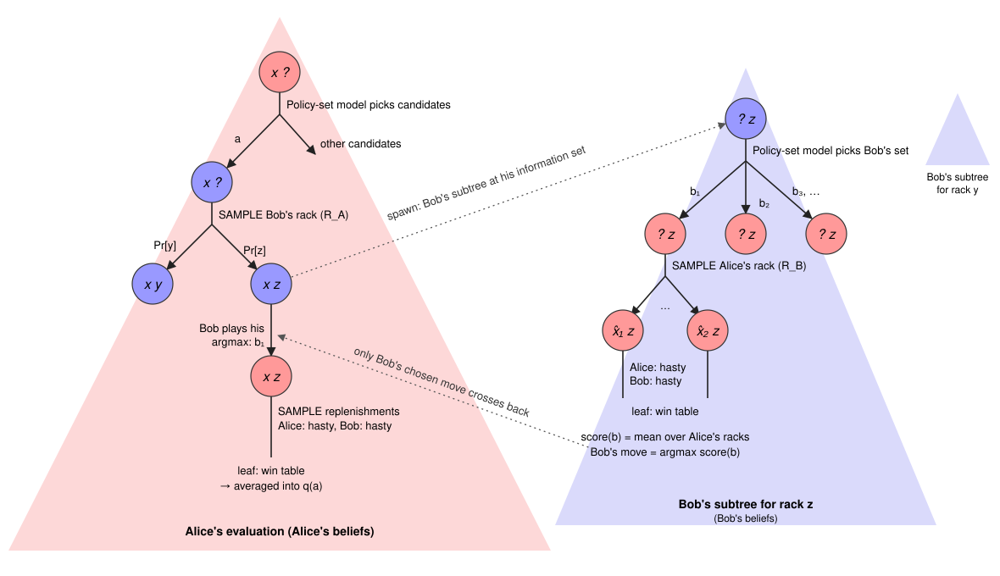

# DeepBot: two-level simulation with a policy-set model

**Status: proposed 2026-10-14; revised 2026-10-25 to build the agent first
on static-equity candidates ([Candidates](#candidates)); revised 2026-11-02
to carry each sim's evidence across the search ([Evidence across the
search](#evidence-across-the-search), [Budget](#budget)); not yet placed in
the [roadmap](../roadmap.md).** DeepBot plays standard Scrabble, with hidden
leaves. This document is a design to guide development. Its measurements
inform the next step; no pass or kill thresholds are fixed in advance.

Write **Alice** for the player to move and **Bob** for the opponent.

## The turn

1. **Candidates.** The [proposer](#candidates) proposes Alice's first
   candidates from all her legal moves. More are
   [admitted](#steering) as the search finds evidence that they may be
   better than the leader.
2. **Bob's racks.** Alice samples `R_A` racks for Bob (about 100) from her
   [belief](#beliefs). They are fixed for the turn and shared by every
   candidate.
3. **Bob's move.** For each candidate `a` and each Bob rack `r`, Alice
   predicts Bob's reply `β(a, r)` by building [Bob's
   subtree](#bobs-subtree), which models Bob's decision on Bob's
   information. A candidate that [empties the
   bag](#when-alices-move-empties-the-bag) skips the subtree. The
   [budget](#budget) decides how many sims each rack's subtree gets; a rack
   whose reply the evidence already settles gets none.
4. **Alice's sims.** For each `(a, r)`, Alice runs several
   [sims](#sims), each with different replenishment draws, after each of
   Bob's contending replies `b`:
   1. Bob plays `b`.
   2. Alice and Bob each play one more move by a mechanical rule.
   3. The leaf is evaluated.

   The mean over draws is her payoff `q_A(a, r, b)`. Her value `q(a)` is
   the mean over racks of her payoff at Bob's reply: at `β(a, r)`, or
   averaged over his contenders by their chance of being his choice where
   his subtree leaves them [tied](#budget).
5. **Evidence.** Every sim, at both levels, is compared with what the
   [search network](#the-search-network) predicted for it. The gaps are
   collected for the turn, and a [reader](#the-evidence-store-and-the-reader)
   carries them to the moves not yet simmed, under every candidate. They
   decide which moves get sims next and where sims stop.
6. **The pick.** Alice plays the candidate with the highest `q(a)`.

## Bob's subtree

Bob's subtree answers one question: given that Alice played `a`, and Bob
holds `r`, what does Bob play?

1. **Alice's racks, from Bob's side.** Bob samples `R_B` racks for Alice
   (about 20) from *his* belief. That belief conditions on the public history
   *including `a`*, and its pool is the tiles Bob cannot see, given `r`.
2. **Bob's candidates.** The [proposer](#candidates), evaluated from Bob's
   information set (`r` plus the public state), proposes his first moves.
   Others are [admitted](#steering) when the turn's evidence lifts them:
   a setup found for one of Bob's racks, under one of Alice's candidates,
   is tried for the other racks that can play it.
3. **Bob's sims.** For each candidate `b` and each of Alice's sampled racks:
   1. Bob plays `b`.
   2. Alice and Bob each play one more move by the mechanical rule.
   3. The leaf is evaluated from Bob's side.

   All of Bob's candidates use the same `R_B` racks and draws, so they are
   compared on paired samples.
4. **The choice.** `score(b)` is the mean over Alice's sampled racks, and
   `β(a, r) = argmax_b score(b)`. Where Bob's leading moves stay within
   noise of each other and Alice's payoffs after them differ, the
   [budget](#budget) keeps them all, weighted by their chance of being
   best, instead of paying to separate them.

**Only the move crosses back.** Alice's sims use `β(a, r)`, never Bob's
scores. Bob's scores are expectations over Bob's belief about Alice's rack,
not over Alice's actual rack, so they belong to Bob's decision and nowhere
else.

*Each triangle is one player's evaluation, colored by whose beliefs it runs
on: red for Alice's, blue for Bob's. Each node is colored by whose turn it is,
and labeled with Alice's tiles, then Bob's, with `?` for tiles unknown to the
evaluation's owner.*

*Alice starts at `x ?`. She holds `x` and cannot see Bob's rack. The
proposer proposes `a` among her candidates. Alice samples Bob's rack
from her own belief, `y` or `z`. At `x z` it is Bob's turn, and Alice cannot
choose Bob's move with her own values, so she **spawns** Bob's subtree, rooted
at `? z`: Bob holds `z` and does not know Alice's tiles.*

*In that subtree, the proposer proposes Bob's set, `b₁`, `b₂`, `b₃`
and others. Bob samples racks for Alice from his own belief, which reads what
`a` reveals (`x̂₁`, `x̂₂`, …). For each of his candidates, he sims: Alice
plays hasty, Bob plays hasty, and the leaf network values the leaf. Each
candidate scores the mean over Alice's sampled racks, and Bob's move is the
argmax, here `b₁`.*

*Only that move crosses back. In Alice's evaluation Bob plays `b₁`; Alice
samples replenishments, both players continue with hasty moves, and the leaf
values average into `q(a)`. Every sampled rack gets its own subtree for Bob
(`y` at right).*

### When Alice's move empties the bag

If `a` draws the bag's last tiles, Bob's turn is an endgame. The tiles he
cannot see are exactly Alice's rack, and his subtree does not apply:

- the policy-set model trains on the whole game except the endgame, so its
  set at an empty bag is outside its training, and the equity proposer's
  recall was measured on the same positions;
- Bob needs no belief about Alice's rack, since he can deduce it, and Alice
  needs no replenishment draws, since there are none.

So for each sampled rack `r`, Alice skips the subtree and plays one sim to
the game's end: Bob and Alice alternate moves by the mechanical rule until
someone goes out or the game stalls, and the exact outcome enters `q(a)`.
This is the play-to-the-end rule of [the sims](#sims), started one move
earlier.

That makes Bob's empty-bag move the one decision in the design that he does
not search. The endgame solver (`EndgameSolver`) could choose it instead.
Measured 2026-10-24 on the first empty-bag position of 200 HastyBot games,
against a reference solve at budget 51,200 (which proved 131 of them):

| On the 131 proven positions | Matches the reference's class |
|-----------------------------|-------------------------------|
| Hasty to the end | 123 |
| The budget-400 solve's move, then hasty to the end | 126 |
| The budget-400 solve's own value, where it proved nothing (103) | 24 |

A budget-400 solve takes 2.4 ms on one thread, a hasty playout 0.34 ms. A
solve that proves nothing gives a usable move but not a usable value. The
solver's move is a later upgrade, worth what an A/B of the agent shows; the
positions above are mostly decided endgames, and the solver's gains in the
[endgame benchmark](../endgame_bench_results.md) sit in close ones.

## Sims

**The mechanical rule** is HastyBot's: static equity over the mover's own
legal moves. It reads only the mover's rack, so the moves it makes cannot
depend on the opponent's hidden tiles. In the whole design, only two
decisions search: Alice's at the root and Bob's in his subtree. Each is made
on its own player's information.

**The leaf: a network.** After a sim's fixed moves, a small network turns
the leaf position into a win probability: the
[leaf eval model](../deep_bot_leaf_eval_results.md), a conv trunk over the
board, the cross-checks, both players' leaves, the pool, the spread and the
pool size.

- **Both leaves are known to the leaf,** because the sim holds both racks:
  the mover's own, and the opponent's as sampled from the mover's belief. The
  network's value at one sampled leaf is not the value of the position as the
  mover sees it; the mean over the sampled leaves is.
- **The value is from the player who just moved.** It is taken from the side
  that owns the evaluation (Bob in his subtree, Alice in hers), as `1 − P`
  when the other side moved last.
- **If the game ends** inside the sim, the outcome is exact.
- **If the bag is empty** after the two mechanical moves, both players keep
  moving by the mechanical rule to the game's end, and the outcome is exact.
  The leaf network trains only on turns that began with tiles in the bag,
  and with both racks known and nothing to draw, the playout is the exact
  value a network would only approximate.

**A sim also returns maps of the board's future.** Besides its value, a sim
reports, for every square empty after its fixed moves, the
[search network's continuation targets](#the-search-network): who places a
tile there, whether that move is a bingo, and the signed points of that
move. Squares filled during the sim's mechanical moves are known exactly.
Squares still empty at the leaf take the leaf network's predictions, which
it makes with the same ownership and points heads. That is how the sim's
value is completed too: what the sim played is exact, and the leaf network
estimates the rest.

**The leaf network is versioned.** It is trained on `.slog` outcomes of the
current policy by the `deep_bot_leaf_eval` workload, which exports each
generation as an ONNX file stamped with its format version and the leave
values it read. The win probability of a leaf shifts as play gets stronger,
so each policy generation gets a new network, and everything it values
records the network's tag, generation and format version.

**A win table stays as a reference.** `P(win | spread + leave value, tiles
unseen)`, fitted from the same outcomes in the CSV format the engine reads
([sim/win_pct_table.h](../../engine/include/sim/win_pct_table.h)), is the
baseline the leaf network is measured against, and the leaf of the CPU sims
that predate the GPU path. It sees neither the board nor the opponent's leave.

**Sims run on the GPU.** A batch of sims is one kernel launch over thousands
of rollouts, one thread block each, with the lexicon tables resident on the
device ([gpu_hasty_rollouts.md](gpu_hasty_rollouts.md)). The kernel plays
every mechanical move, leaves each rollout's end state in device memory, and
a second kernel writes the leaf network's input rows straight into the
TensorRT engine's input buffers. Only three floats per rollout come back,
plus the maps above summed on the device over each candidate's rollouts, since
a full map per rollout would dwarf the rest of the transfer. A CPU reference
implements the same sim move for move, and the kernel matches it rollout
for rollout.

Every sim in the design has the kernel's shape: a position in which one
player has just moved, then the two mechanical moves, then the leaf from that
player's side (or, with the bag empty, the game played to its end).

- **Bob's sims** start after his candidate `b`; Alice and Bob reply hastily.
- **Alice's sims** start after Bob's reply `β(a, r)`, which the host applies
  to the board, since it is a fixed move. The position is then one in which
  Bob has just moved and Alice's leave is known, and the value is flipped to
  Alice's side.
- **Label sims** start after the candidate; the opponent and the chooser
  reply hastily.

The demo runs one position at a time. One launch is to take
([deep_bot_v0.md](deep_bot_v0.md#build-order), step 9):

- **many positions, in groups that share an unseen pool:** a group is the
  candidates of one chooser at one position, each applied to the board (a
  pool's candidates, Bob's set at one `(a, r)`, or Alice's sims of one
  `(a, r)`), and a launch holds as many groups as fill it;
- **per-rollout opponent leaves,** sampled on the host from the mover's
  belief, or known (Alice's own leave, in her sims); the kernel draws the
  rest of the rack;
- **a range of rollout indices** per group, so racing can run in rounds.

**Racing runs in rounds.** A round is one launch: a slice of the rollouts
for every candidate still in the race, then the host compares the candidates
on their paired samples and drops the clearly beaten ones before the next
round. Rollout `i` is the same deal in whichever round it runs. Rounds from
many positions and subtrees share each launch, so a launch stays large while
each race is narrow.

**Pairing.** Samples come from variates keyed by `(sample index, draw
ordinal)`:

- **Bob's racks** come from Alice's unseen pool, which does not depend on her
  candidate. So every candidate meets exactly the same `R_A` racks, and
  comparisons between candidates are paired.
- **Within Bob's subtree,** all of his candidates share the same `R_B` racks
  for Alice and the same draws.
- **Replenishments** come from each player's own end of one bag per sample,
  shuffled once: Alice draws from one end and Bob from the other, so each
  player's k-th tile is the same whichever candidate she played and however
  many tiles either of them draws. In Alice's sims after Bob's reply, that
  bag is the bag as she found it (her leave seated, her exchanged tiles
  returned after her draw), the same for every candidate, so her candidates
  stay paired on Bob's draws too.

A seeded, indexable draw sequence replaces the `Game`'s bag in sim code: the
GPU kernel's counter-based generator (Philox, keyed by the batch seed and
counted by rollout index), which the CPU reference shares. Rollout `i`
shuffles the same pool the same way in every start of a group.

## Candidates

**The proposer.** Given a position from the chooser's information set and a
size `N`, the proposer returns `N` of the chooser's legal moves. Alice's
first candidates and Bob's first moves at each rack both come from it. The
set is where the search starts, not where it ends: [steering](#steering)
admits the moves the turn's evidence lifts.

**v0 proposes the static-equity top `N`.** The learned forms of the
[policy-set model](#the-policy-set-model) so far match that baseline and do
not beat it, so the agent is built on it, and the policy-set model replaces it
once it beats equity at the same `N`. The equity proposer needs no network:
one move generation per set, on the CPU. Bob needs a set per `(a, r)`, about
2,000 per turn, each well under a millisecond.

**`N` depends on the stage of the game.** Measured 2026-10-25 on 2,000 pools
labeled on the GPU ([Labels](#labels): every legal move, Bob's reply hasty,
the leaf network at the end). A pool's best move is its largest `q`. Regret
is the best move's win probability minus that of the set's own best-`q`
move, in points of win probability:

| `N` | Recall, all | Regret, turns 0–5 | Regret, turns 6–11 | Recall, turns ≥ 12 | Regret, turns ≥ 12 | 95th-percentile regret, turns ≥ 12 |
|---|---|---|---|---|---|---|
| 4 | 0.800 | 0.13 | 0.14 | 0.679 | 1.35 | 6.5 |
| 8 | 0.866 | 0.06 | 0.06 | 0.750 | 0.98 | 4.9 |
| 16 | 0.905 | 0.03 | 0.05 | 0.815 | 0.79 | 3.8 |
| 24 | 0.928 | 0.02 | 0.01 | 0.852 | 0.58 | 2.7 |
| 40 | 0.944 | 0.01 | 0.01 | 0.878 | 0.42 | 1.6 |

Turn counts both players' moves; the pools record no bag size. Each turn
bucket holds 600 to 800 pools. Through turn 11 the top 8 lose almost nothing.
From turn 12 on, the top 8 miss the best move a quarter of the time, and even
the top 40 lose 0.4 points on average. So `N` grows with the stage, about 8
early and 24 to 40 late, which makes late turns several times dearer in Bob's
subtree. The late game is also where a learned proposer has room to beat
equity.

**The reply model.** How Alice models Bob's move is a knob:

- **`subtree`:** Bob's subtree, as designed.
- **`hasty`:** Bob plays the static-equity argmax for `r`, which is Macondo
  BestBot's model of the opponent, here with the leave inference beliefs and
  the leaf network. The subtree is skipped, which makes a turn about 40 times
  cheaper ([Cost and allocation](#cost-and-allocation)).

- **`alice-subtree`:** Bob plays HastyBot's move, and the search moves to
  Alice's second turn. At each `(a, r)` she holds the rack her refill drew,
  samples Bob's leave from her belief after his reply, and sims her own
  static-equity top moves. The move she picks then gets two hasty plies and
  the leaf network, which value `a`. Against a HastyBot opponent the reply
  model is exact, so what this setting measures is Alice modeling her own
  later play as a searcher rather than as HastyBot. `--second-candidates 1`
  keeps the depth (four hasty plies to the leaf) without her search: the
  control for what depth alone is worth.

`hasty` is the first pass of successive halving, and the two settings at
equal time measure what modeling Bob on his own information is worth.
Against HastyBot itself that comparison cannot favor the subtree, since
`hasty` is then Bob's exact model. That is the case `alice-subtree` is for.

## Evidence across the search

Bob's subtrees dominate a turn's cost ([Cost and
allocation](#cost-and-allocation)), and run independently they are weak as
well as dear:

- **One subtree cannot separate close moves.** In the policy-set pools, the
  per-rollout difference between two moves spreads 11 to 16 points of win
  probability, against typical margins of about 1 point. At `R_B = 20`, the
  standard error of a difference between two of Bob's moves is about 3
  points, and separating a 1-point margin would take on the order of 700
  samples. Measured 2026-10-27, rerunning a subtree at `R_B = 20` chose the
  same reply 35 to 55% of the time.
- **Every subtree rediscovers the same lessons.** Bob's racks are the same
  under every candidate, and any one candidate leaves most of the board
  untouched. A setup that pays for one rack is open to every rack that can
  play it, under every candidate that leaves its lane alone.

So a sim's result is also evidence about the rest of the tree. The evidence
is the gap, the **residual**, between what a sim found and what a network
predicted it would find. Three pieces carry it: the search network makes the
predictions, the sims' residuals are stored for the turn, and a reader
applies them to moves not yet simmed.

### The search network

The search network predicts, for a move from a player's information set,
what the sims after it will measure. It reads the board, the cross-checks,
the unseen pool, the bag count, the scores, the evaluator's own rack and
the evaluator's [belief](#beliefs) about the opponent's rack, summarized per
letter. It builds on the move set model's trunk and move encoder, so the
board is encoded once per position and each candidate adds only its own
features.

The **evaluator** is the player whose evaluation the sims belong to: Bob in
his subtree, Alice in hers. Per-player targets are written from the
evaluator's side.

**Continuation heads.** These predict what follows a fixed move (or moves)
when play continues as the [sims](#sims) play it: the mechanical moves, then
the leaf.

- **Value:** the evaluator's win probability.
- **Ownership:** for every empty square, five classes: the evaluator places
  a tile there in a bingo, the evaluator places one in another move, the
  opponent does either, or the square stays empty to the game's end.
- **Points:** for every empty square, the expected signed points of the move
  that places a tile there (positive for the evaluator, negative for the
  opponent, zero if it stays empty), and their variance.

Why the targets have this shape:

- **The bingo split costs nothing.** The five classes sum to the three that
  say only who places the tile. A bingo lane is open to a whole class of
  racks, the bingo-prone ones, rather than to particular tiles, and bingos
  carry a timing effect of their own (seven tiles turned over), so the
  split gives a direct read that the points cannot.
- **Points are the whole move's, not a share.** A move scores as a unit,
  and a square's danger is what the move through it scores: a hook
  dangerous because of a 63-point bingo along it is a 63-point square, not
  a 9-point one. Unlike Go's ownership, the points map therefore does not
  sum to the score. Go places one stone per turn; a Scrabble move places
  one to seven tiles, so a share per tile would dilute the large moves.
  The value head carries the score.
- **Points are unconditional, with variance.** Every sim gives every square
  a residual, with an empty square counting zero. A head conditioned on a
  class would get evidence only when that class occurred, which for a
  rare class on a given square is seldom. The variance separates a likely
  small move from an unlikely large one with the same mean; the ownership
  classes add who would make it.
- **Losses fit moments, not a Gaussian.** The points target is a spike at
  zero plus scattered large values. The mean trains on squared error, and
  the variance on squared error against the squared deviation from the
  predicted mean, with no gradient through that mean. Each is consistent
  whatever the target's shape. In the transfer test, plain Gaussian
  likelihood let a head lower its loss by widening its spread instead of
  moving its mean ([supreme_bot_m1a.md](supreme_bot_m1a.md)).

**The reply-policy head.** `π_B(b | board after a, r, Bob's belief)`: the
probability that Bob's subtree chooses `b`. It is the
[policy form](#form-3-a-policy) of the policy-set model, trained on the
replies Bob's subtree actually chose, rather than on pools with a hasty
reply. It is where the searching Bob lives in the network. Every value
in the design is a continuation after fixed moves; searching changes only
which moves are fixed. So Alice's prediction for a candidate decomposes as

`q̂(a) = mean_r Σ_b π_B(b | a, r) · V(a, b)`

with `V` the value head from Alice's side after `a` and `b`.

**Maps are computed only for simmed moves.** A residual map needs the
predicted map of the post-move board, which is a spatial decode per
candidate. Moves that get sims need it to form their residuals; moves that
don't need only the reader's scalar predictions.

**Labels.** Two sources, both exact for what they label:

- **Game records.** A `.slog` replay knows who placed every tile, in which
  move, for how many points, whether the move was a bingo, and who won. The
  continuation heads pretrain on that for free, as KataGo trains its
  ownership head on finished games.
- **The agent's search records.** Each turn yields, for every simmed
  `(a, r, b)`, Bob's sim results and maps; for every `(a, r)`, his choice
  and each contender's chance of being best; and Alice's sim results and
  maps after his contenders. These train the continuation heads on the
  positions search actually visits, and `π_B` on searched replies.

### Residuals

Every sim yields, against the search network's prediction for its fixed
moves:

- **a value residual:** the sim's value minus the predicted value;
- **map residuals:** for each square, the realized class minus the predicted
  class probabilities, and the realized signed points minus the predicted
  mean (and the squared deviation minus the predicted variance).

At Bob's level, each rack also yields a **reply residual**: his subtree's
choice, or its chance-of-best weights, against `π_B`. That is the lesson
"after this candidate, a rack like this one replies there", and it is keyed
by the squares the reply uses, which is what lets it travel.

### The evidence store and the reader

The **evidence store** holds the turn's residuals. Each item records:

- the fixed moves: Alice's candidate `a`, and at Bob's level his rack `r`
  and move `b`;
- the squares each move places tiles on, and the cross-check changes it
  makes;
- the context after `a`: the bag count, and Bob's belief summary about
  Alice's rack;
- the leave of the rack that moved.

There is one store per turn, not one per candidate.

The **reader** is a network that, given a target (one of Alice's moves not
yet simmed, or one of Bob's moves at one rack under any candidate), predicts
a correction to the search network's prediction for it: the value residual,
as a mean and a variance, and at Bob's level a correction to `π_B`. With no
evidence its correction is zero, so a search starts from the search
network's predictions. It attends over the store by two kinds of match:

- **Region:** whether the target places tiles on, or changes the hooks of,
  the squares an item's residuals concern, and whether the target's
  candidate leaves intact the squares and hooks an item's reply used. A
  candidate that blocks a lane cuts off the evidence that lane produced.
- **Context:** whether the item's bag count, leave and belief match the
  target's. A setup whose payoff depends on the opponent being unable to
  go out after a bingo pays when two tiles remain in the bag and not when
  five do. Whether a rack can use a lane depends on its tiles: a hook only
  an S fills pays for a rack holding the S, or likely to draw it. So both
  sides' context is an input.

**Evidence crosses candidates.** Bob's racks are shared by every candidate,
and any one candidate leaves most of the board unchanged. A reply found
under one candidate therefore informs Bob's racks under every candidate
that leaves its region intact in a similar context. Most of the redundancy
between subtrees lies there.

**Training: masked prediction on the search records.** Hide whole candidate
contexts, or racks within one, and predict their residuals and replies from
the rest of the turn's evidence. That is the reader's task in search,
including the cases where transfer should fail (a lane blocked, a different
bag count). The value loss is a likelihood (beta-NLL, as in the transfer
test), so the predicted variance is calibrated: the [budget](#budget) relies
on it.

**Generations.** The search network learns to predict the agent's own
search, and the next agent searches with it, as in AlphaZero. Over
generations the heads absorb the common lessons, and the reader is left
with what is new in each position.

### Steering

A move is admitted for sims by its expected improvement over the current
best: Alice's leader at the root, the rack's leader at Bob's level. Its
mean is the search network's prediction plus the reader's correction, and
its spread is the reader's variance. A move the evidence lifts enters
whatever the proposer thought of it; a move predicted to be far below
the leader is never simmed. A small floor on admission keeps a wrong
prediction from going uncorrected forever: a move that is never simmed
never produces the evidence that would correct it.

## The policy-set model

**Interface.** Given a position from the chooser's information set, all legal
moves and a size `N`, return a set `S` of `N` moves.

**The chooser's belief is an input.** The model also reads the chooser's
belief about the opponent's rack, from the
[leave inference model](#the-leave-inference-model), summarized per letter.
The labels are simmed with opponent racks drawn from that belief, so without
it the model would have to re-infer it from the board alone, with no move
history and no forgone plays. With it, a setup the opponent's last move left
can be read as "he likely holds the hook letter", and blocking it valued
accordingly. The chooser always has this belief: at Alice's root it is hers
about Bob, and in Bob's subtree it is his about Alice given `a` and his
sampled rack `r`, the belief his sims already draw from.

The opposite belief, the opponent's about the chooser's rack, is left out:
at Alice's root it needs a model that infers from public information alone,
since Alice does not know Bob's rack, and current labels could not teach its
use, since rollouts never read a belief.

**Objective.** Choose `S` to maximize the expected best value in the set,
`E[max_{a∈S} v(a)]`, where `v` is the move's value under the chooser's
uncertainty about it. This differs from taking the `N` moves most likely to
be best one at a time: a set of near-identical moves adds little over its
best member, so the objective rewards diversity. Of a strong play and four
near-copies of it, the set is better with one copy replaced by a different
kind of move, such as a setup that wins in other worlds.

Two forms of the model meet this objective, and a third, a policy, sets
diversity aside. All build on the move set model's architecture (the board
trunk, the move encoder and the cross-check encoder), and all train on the
same labeled pools ([Labels](#labels)). Which works better is measured.

### Form 1: greedy selection, with cached steps

The expected max of a set of win probabilities is monotone and submodular, so
greedy construction comes within a factor of `1 − 1/e` of the best set. The
policy-set model picks one move at a time, each maximizing its predicted gain
over the moves already chosen:

`gain(a | S) = E[max(0, v(a) − max_{s∈S} v(s))]`

`S` starts from the seed, the static-equity top move, rather than empty. At
`S = ∅` the gain would be the value itself: a whole win probability, where
every later step's is a margin of a few points, so that one step would set
the gain loss's scale. Seeded, every step asks which move most improves on a
real one; the seed is the sim-best move about half the time, so a set of two
or more would hold it anyway. Greedy from a fixed seed keeps the guarantee
for the moves it adds.

The expectation is over what the sims have not resolved about the values,
not over the game's own luck. A training pool's sims leave each pair of
moves a mean difference with a standard error, so each member `s` of `S`
gives `a` an expected improvement under that uncertainty,
`E[max(0, μ_a − μ_s)]`. The target is the least of them. Since
`max_S μ ≥ μ_s` for every member, each is an upper bound on the gain over the
set's best, and the least is the tightest. It matters when `a` sims as a
member does: if `A` is the set's best and `B` a member `a` duplicates, then
`a` beats `A` only where `B` already does. Against `A` alone `a` would look
promising; against `B` its improvement is 0. The bound is loose only when the
set covers `a` jointly and no single member does, and then it errs toward
crediting `a`. The exact value (resampling the paired rollouts and comparing
`a` with the set's best on each resample) is the alternative if that proves
to matter.

An expectation over rollouts instead, `E_r[max(0, v_r(a) − v_r(s))]`, was
considered and rejected. It is half the mean margin plus half the mean
absolute per-rollout difference, and that per-rollout spread (11 to 16
points, inferred from the pools' paired standard errors) dwarfs typical
margins (about 1 point), so it would rank moves by volatility: a move 5
points worse than the set's best but volatile would outrank one 2 points
better.

A stage conditions each move's
query on the tokens of the moves already chosen. The evidence-fusion stage
built for [sim_residual_feedback.md](sim_residual_feedback.md) already
conditions on a set of move tokens. There the tokens carried sim results;
here they are chosen moves alone. Its proves-best head is the same quantity
with "simmed" in place of "chosen".

Built naively, `S` takes `N` sequential network calls. Most of each call does
not depend on `S`: the board trunk, the move encodings and the cross-check
encodings are computed once per position and cached. Each step reruns only
the set-conditioning stage and the gain head, a small fraction of a full
pass. This is the cache-graph and step-graph split the evidence path already
uses ([evidence_staging.h](../../engine/include/agent/evidence_staging.h)).
Total compute is about one full pass plus `N` light ones, but the steps
remain serial.

### Form 2: a one-shot slot decoder

The network outputs the whole set in one pass, in the manner of set
prediction (DETR; Carion et al., 2020):

- `N_max` learned query slots cross-attend to the encoded moves and
  self-attend to each other.
- Each slot points to one move, through a softmax over the legal moves of the
  dot product between the slot's query and each move's embedding.
- Because the slots attend to each other within the pass, training teaches
  them to divide the moves among themselves. Diversity comes from joint
  training, not from sequential conditioning.

**The loss is coverage of the best move.** Let `q(a)` be the label
distribution over which move is best, and `p_k(a)` the probability that slot
`k` points to `a`. With the first `N` slots,

`L_N = −Σ_a q(a) · log(1 − Π_{k ≤ N} (1 − p_k(a)))`

which is the negative log-probability that the set contains the best move.
Once one slot covers a move, another slot pointing there adds almost nothing,
so across positions that look alike but have different best moves, the slots
spread over the plausible winners. This is the mechanism of multiple-choice
learning: several outputs trained so that at least one is right. The loss
counts a set whose best move falls just short of the true best as a miss;
soft labels soften that ([Labels](#labels)), and expected regret,
`v(a*) − max_{a∈S} v(a)` with softmax pointers, is the alternative if margins
need more weight.

**Any `N` from one pass.** Training sums the loss over prefixes,
`Σ_N w_N · L_N`. Slot 1 then learns the best single move, slots 1 and 2 the
best pair, and so on, so the first `N` slots serve any `N ≤ N_max`: Alice's
`N_A` and Bob's `N_B` come from the same pass. At inference, a slot whose
move an earlier slot already took falls back to its next choice.

### Form 3: a policy

The network gives each legal move one logit, and a softmax over the
position's moves, however many it has, makes a policy `π`. The loss is the
cross-entropy against `q`, `−Σ_a q(a) log π(a)`, and the set of `N` is the
policy's top `N`.

The events "`a` is the best move" are disjoint, so `Σ_{a∈S} q(a)` is the
probability that `S` holds the best move. A policy that matched `q` would
therefore make the best set for recall and cover at every `N`, from one
pass. What it gives up is the objective's diversity term, which only
regret rewards. Measured on stored pools, that term is small in Scrabble:
skipping a member whose rollouts track an earlier member's deal for deal
left regret unchanged (0.721 vs. 0.722 points at `N = 8`).

### Many sets at once

DeepBot builds many sets per turn. Bob's subtrees alone need one per
`(a, r)`, about 100 per candidate. With either form, each network call is one
batched call over all the sets in progress. Form 1 makes `N` such calls, all
but the first of them light; forms 2 and 3 make one.

### Labels

A labeled position is a pool of candidate moves with values from sims, run
from the chooser's information set: the opponent's leave is drawn from the
chooser's [leave inference](#the-leave-inference-model) belief, with a
uniform refill, and the sims are paired across moves.

- **Candidates: every legal play and every distinct exchange, plus the pass,
  including blank plays.** A blank multiplies the moves through its
  designations, so one prune applies: a blank move (a play that places the
  blank, or an exchange that returns it) is dropped when its score is 40 or
  more points below the greedy move's, the highest-scoring play. An exchange
  scores 0 under this rule.
- **Pools need the tail.** The pool must include moves the prior ranks low
  (exchanges, short plays, setups), or the policy-set model never learns that
  they can win. The exhaustive survey recipe of
  [sim_labeled_candidates.md](sim_labeled_candidates.md) (every legal play)
  produces this shape of data.
- **The labels can see moves the rollout policy never plays.** Every
  candidate is simmed directly, rather than reached by a rollout policy that
  would have to choose it. A setup that static equity ranks low is labeled by
  its own outcome, provided its payoff arrives within the sim's horizon.
- **Form 1's targets: subset assembly.** Any subset `S` of the pool, plus a
  held-out move `a`, gives a row whose target is the least expected
  improvement of `a` over a member of `S`, computed from the paired rollout
  values (see Form 1). One pool yields many rows.
- **Form 2's targets: a soft best move.** `q(a)` is the probability that `a`
  is best under the paired sim statistics: by bootstrapping over the paired
  samples, or by a normal approximation to the paired differences against
  the leader. Near-equal moves share the mass, so the slots learn that either
  will do. Racing stops weak moves early, on fewer rollouts, and both
  estimates account for that, since a move far below the leader rarely comes
  out on top.

**Label rollouts stop at the leaf network.** Played to the end of the game,
a rollout is slow and its outcome noisy. A label rollout instead plays the
two mechanical replies on the GPU and ends at the [leaf network](#sims),
whose identity the pool records.

**Generations.** Once DeepBot runs, its own evaluations label positions, and
each policy-set generation trains on the previous agent's labels, as the move
proposal model's generations do.

## Beliefs

Two beliefs feed the design: Alice's over Bob's rack (step 2 of the turn), and
Bob's over Alice's rack given `a` (step 1 of his subtree). Both come from one
model.

### The leave inference model

The **leave inference model** predicts the opponent's **leave**, the
tiles they kept from their last move, from the observer's view of the game.
The opponent's rack is that leave plus a refill drawn uniformly from the rest
of the observer's unseen pool, which is exact: the refill is a uniform draw.
The leave itself is drawn from the **leave pool**: the unseen pool less any
tiles the observer exchanged just before the opponent's last move. The
opponent's rack predates that exchange, though the refill may hold its tiles.
The leave's length is public: the opponent's rack size minus the tiles their
last move played or exchanged (a pass keeps the whole rack).

**Inputs.** The leave inference model is a standalone model, with its own
encoder and network, sharing no trunk or weights with another model. From the observer's view, it
reads:

- **the current position:** the board, the current cross-checks, the
  observer's rack, the unseen pool, scores and the bag count, and the tiles
  the observer exchanged on each of their last two turns, if they did;
- **the opponent's last 3 moves.** The observer's own moves say nothing about
  the opponent's leave beyond the board, except those exchanges. For each move, the squares it placed tiles on;
  the cross-checks as they stood *before* it was played, so the model sees
  which hooks and lanes the player had and passed up; and its tiles played,
  whether it was an exchange or a pass, its score and the bag count then;
- **the opponent's forgone plays:** for each of their last 3 moves and each
  tile kind `τ`, how much more the best play needing `τ` (the move's tiles
  plus one more `τ`) would have scored. The network cannot search the lexicon
  for this itself, and a large margin says the leave probably lacks `τ`
  ([deep_bot_v0.md](deep_bot_v0.md#forgone-plays)).

**The output: 29 floats.**

- **`θ_l`, one per letter (27):** a log-weight for "the leave contains `l`".
  Positive means likely has it, negative means likely doesn't, so one number
  covers both reads.
- **`a` and `b ≥ 0`:** a tilt on the leave's absolute quality `v(ℓ)`, its
  static leave value in equity points.

Those numbers define the leave distribution as the pool prior, tilted:

`log p(ℓ) = log P_prior(ℓ | pool) + Σ_{l ∈ ℓ} θ_l + a·v(ℓ) − b·v(ℓ)² − log Z`

over leaves `ℓ` of the public length that the leave pool can supply. `P_prior` is the hypergeometric draw from that pool: `Π_l C(n_l, c_l)`
up to a constant, where `n_l` is the pool's count of `l` and `c_l` the
leave's.

- **`a = b = 0` is exactly "no information":** the leave is a uniform draw
  from the pool. `a > 0` shifts belief toward better leaves, `a < 0` toward
  worse ones, and `b > 0` concentrates it around a value.
- **The quality term carries the interactions.** Leave value already folds in
  balance, synergy, duplication and stems, so one tilt moves a whole class of
  leaves at once: raising `a` favors well-balanced, bingo-prone leaves and
  leaves unbalanced ones down. The letter terms stay per-letter, which is all
  the has-it and doesn't-have-it reads need.
- **Quality is absolute.** The tilt acts on leave value in points, against
  whatever the current pool can produce. With both blanks unseen, a positive
  `a` reaches up to blank leaves; with both played, it favors the best leaves
  that remain.

**The leave tables.** Static, built once offline, one per length from 1 to 6.
Each row is a leave: its 27 counts, a 27-bit presence mask, and `v(ℓ)`. The
6-tile table has 737,311 rows (about 30 MB); the 4-tile table has 25,254. A
7-tile leave arises only from a pass and is sampled from the prior alone. If
leave values become board-aware, only the `v(ℓ)` column changes, per position.

**Likelihood and training.** One pass over the table for the leave's length
gives the exact log-likelihood:

1. **Per-letter prior terms:** `log C(n_l, c)` for each letter and count, at
   most 27 × 8 values.
2. **Each row's log-weight:** skip the row if some `c_l > n_l`; otherwise
   `Σ_l logC[l][c_l] + Σ_{l ∈ mask} θ_l + a·v − b·v²`, about 28 additions.
3. **`log Z`** is the log-sum-exp of the log-weights, and the loss is
   `log Z` minus the true leave's log-weight.

Training directly on this likelihood matters. Per-letter has-it classifiers
and a separate quality regressor, trained independently, would give marginals
that are not the weights to multiply together. Trained jointly, the outputs
*are* the weights, and the readable per-letter probabilities ("likely has an
S") come out of the same pass as marginals, along with the implied mean and
spread of the opponent's leave value.

**Sampling.**

- **Algorithm 1: enumerate, then inverse CDF.** Compute every row's
  log-weight, exponentiate against the maximum, and take a running sum in the
  table's fixed order. For each sample's variate `u ∈ [0, 1)`, binary-search
  the CDF for `u × total`; that row is the leave. Then add the refill. A
  6-tile query is about 20M additions, 10–20 ms on one CPU thread, and each
  sample after that is a binary search. Because the order is fixed and
  sampling inverts a CDF, one variate gives the same leave whenever two
  queries have the same distribution, so samples pair across candidates. The
  same pass computes `log Z`, so training, evaluation and sampling share one
  implementation.
- **Algorithm 2: per-letter proposal, then rejection.** Drop the quality
  factor. What remains, `Π_l C(n_l, c_l) · exp(θ_l [c_l > 0])` at fixed length,
  factors over letters, so a small table of partial sums over (letter, tiles
  still to place) gives exact sampling by walking the letters. Accept with
  probability `exp(a·v − b·v² − M)`, where `M` bounds the quality term over
  that length's values. Accepted samples are exact. When the tilt is strong
  the acceptance rate falls, so the sampler estimates it from a few trial
  draws and falls back to Algorithm 1 below about 5%. Pairing is looser,
  since a varying number of variates is consumed.

| Use | Volume | Algorithm |
|---|---|---|
| Policy-set label generation | one query per position, ~300 samples | 1, on the CPU |
| The agent, Bob's beliefs | ~2,000 queries per turn, ~20 samples each | 1, batched on the GPU |
| Many unbatched CPU queries | — | 2, falling back to 1 |

**Conditioning on Alice's candidate.** Bob's belief about Alice is the leave inference
model run from Bob's view, with Alice's candidate `a` as the most recent move of
its history. That is one forward pass per `(a, r)`, batched on the GPU
(`belief::ReplyView`).

**Bob's private past is hidden.** The row reads the observer's own past: the
tiles they exchanged on their last two turns, and their racks at the time of
the older history moves, through those slots' leave-kind masks. Inside Alice's
model, Bob's real past is not hers to see, and it would contradict the rack `r`
she sampled for him. So Bob's row hides it (`LeaveHistory::hide_private`): no
exchanges, the older slots' masks open to every kind, nothing subtracted from
the leave pool for his exchange, and an input flag that says so. The newest
slot, `a` itself, keeps a mask read from `r` and that pool.

Training hides it too, in a fraction of rows (`hide_private_fraction`, 0.25 by
default), so the model learns both readings rather than meeting the hidden one
only at serving time, as KataGo trains on positions with their history removed
for analysis without a game record. Each generation's held-out eval scores the
same rows both ways and charts the gap (`eval_hidden_gap`), so a model that
learns to lean on the private past shows it. Before the flag existed, a model
trained without hidden rows lost +0.0001 ± 0.0006 nats to the hidden form on
tilted2's held-out rows, and on the 2% of rows whose observer had just
exchanged, zeroing the exchange alone improved the NLL by 0.048 ± 0.014 nats.

### Generations

A frozen policy `P_k` generates games, and those games train `I_k`, the
`k`-th leave inference model.

- **The labels are free.** A `.slog` stores the initial racks and every move
  with the tiles drawn after it, so replay reconstructs every player's true
  leave at every turn ([architecture.md](../architecture.md)).
- **Train `I_k` only on `P_k`'s games, warm-started from `I_{k−1}`.** Trained
  on a buffer that mixes generations, an inference network converges to Bayes'
  rule under the *average* policy, not the current one. Once a policy-set
  model serves, games for `I_k` are generated cheaply, by playing `P_k`'s
  policy-set model's top-1 without search. Under the equity proposer that
  top-1 is HastyBot, the policy `I_0` already models, so games come from the
  agent itself at a reduced budget.

`I_k` models opponents who play like `P_k`. Against Macondo or human players
that is a mismatch. Fine-tuning on recorded games with known racks is the
later remedy.

## Cost and allocation

Per Alice candidate, with fixed counts:

| Item | Count |
|---|---|
| Candidate sets for Bob | `R_A`: 100 |
| Bob's sims | `R_A · N_B · R_B`: 100 × 8 × 20 = 16,000 |
| Alice's sims | `R_A ·` sims per rack: about 400 |

Modeling Bob dominates, at about 40 to 1, and scales with `N_B`, which the
equity proposer needs larger late in the game ([Candidates](#candidates)).
With 20 candidates, a turn is
about 320,000 short sims, each two mechanical moves after a fixed one, and a
leaf network evaluation. On the dev laptop's GPU (RTX 5000 Ada), the rollout
kernel runs 140,000 to 540,000 two-ply rollouts a second, depending on how
many racks hold a blank, and the leaf network about 270,000 evaluations a
second in FP16; together, 90,000 to 170,000 sims a second
([gpu_hasty_rollouts.md](gpu_hasty_rollouts.md#the-leaf-network-on-the-device)).
That is roughly 2 to 4 seconds a turn. The same sims on the 28-thread CPU,
with the win table as the leaf, ran 20,000 to 164,000 rollouts a second in the
same measurement, so 2 to 16 seconds a turn; with the leaf network fed from
the host, the input upload bounds them at about 48,000 evaluations a second.

**The counts are CPU-sized.** On the GPU a launch wants 10,000 rollouts or
more to fill the device, and a turn's time is its number of racing rounds
times a round's launch, since every subtree's round shares the launch. Width
(`N_A`, `N_B`, `R_A`, `R_B`) costs throughput, not rounds, so the GPU may
favor wider sets and more racks than the counts above, with fewer rounds.
The round schedule is re-tuned there by measurement.

### Budget

Fixed counts give every `(a, r)` the same `N_B · R_B` sims, whatever the
turn has already learned. With the [evidence](#evidence-across-the-search),
each of Bob's moves at each rack carries a belief about its value to him:
the search network's prediction plus the reader's correction, with the
reader's variance, updated by the move's own sims as they arrive. Three
decisions read those beliefs.

1. **Which of Bob's moves get sims.** At each rack, the moves with a real
   chance of being his best, which replaces a fixed `N_B`
   ([Steering](#steering)).
2. **When a rack stops.** When one move's chance of being best is near
   certain, or when Alice does not care which of his contenders he plays:
   her payoffs `q_A(a, r, b)` after them barely differ. At fixed counts
   she runs a few sims per rack against his `N_B · R_B` (about 160), so
   simming after each of his contenders costs her little, and her payoffs
   say where his choice matters. Where his contenders stay within
   noise of each other and her payoffs after them differ, more sims cannot
   settle it at any affordable count (about 700 samples for a 1-point
   margin, [above](#evidence-across-the-search)). Her payoff there is the
   mean over his contenders, weighted by their chance of being best.
3. **Which racks get sims at all.** A rack whose reply the beliefs already
   settle before any sims gets none, and its `β(a, r)` is the predicted
   move. A small random share of such racks is simmed anyway, as an audit.
   Where an audit disagrees with the prediction, the reader's variance
   widens for the rest of the turn, and more racks get sims.

Decisions 2 and 3 choose Bob's reply from predictions in place of sims.
Only the move crosses back, so a wrong prediction picks a wrong reply for
that rack, while Alice's payoff after it still comes from her own sims.

**At the root,** each candidate's payoffs bound what any model of Bob could
make of it: `q(a)` lies between `mean_r min_b q_A(a, r, b)` and
`mean_r max_b q_A(a, r, b)` over Bob's contenders. A candidate whose upper
bound is below the leader's lower bound needs no more of Bob's sims.

**One allocator.** All of a turn's sims go through one queue, and each
racing round is one GPU launch built from its top. A sim of Bob's move is
worth roughly the chance it changes his choice at that rack, times how much
that changes Alice's payoff, times the chance its candidate still
contends. Alice's sims and her candidates' first passes join the same
queue.

Three cheaper levers remain:

- **Successive halving over Alice's candidates.** A first pass models Bob
  as the proposer's top-1 (the `hasty` reply model). The subtree runs only
  for candidates that survive it.
- **Caching `β(a, r)`.** Every replenishment sim of `(a, r)` reuses Bob's
  choice.
- **Batching** the network calls (the leave beliefs, the search network
  and the reader) across subtrees, following the `BatchingPositionEvalService`
  pattern.

## Build order

Each step names what it measures. The measurements guide the next step.
Steps 1 to 3 are planned in detail in [deep_bot_v0.md](deep_bot_v0.md).
Steps 4 to 6 run on the equity proposer, so step 3 does not gate them.

1. **The leave inference model, `I_0`,** from HastyBot games, and the v0
   win table. *Measure:* held-out log-likelihood of the true leave against
   uniform draws.
2. **Policy-set labels.** Pools over positions from the whole game except the
   endgame, with opponent leaves from the leave inference model and rollouts
   run on the GPU, stopped at the leaf network.
3. **Policy-set v0, both forms,** in parallel with steps 4 to 6. It
   replaces the equity proposer once it beats it. *Measure:* recall, meaning how often the
   pool's sim-best move is in `S`, against the top `N` by value, by form, bag
   size and `N`, with setups and exchanges reported separately; and each
   form's time per batch of sets. The equity baseline's curve is in
   [Candidates](#candidates).
4. **Bob's subtree, offline.** At known positions, for Bob's sampled racks
   after each of Alice's top candidates: Bob's chosen replies, how often
   each kind (bingo, setup, other) is chosen, and how stable the choice is
   in `R_B`. DeepBot's `--subtree-dump` records these per turn in play
   (agent/subtree_dump.h), in place of a separate tool.
5. **The agent.**
   - The GPU sims with groups and racing rounds, the leaf network, pairing,
     two-level evaluation with inferred-leave beliefs batched on the GPU, and
     the cache.
   - The proposer's `N` by stage of the game, and the reply-model knob.
   - *Measure:* the picks at the known positions
     (`positions/NWL23/interesting-positions/`, the blind_spots tag), turn
     time, and matches against BestBot and `mset-sim` in standard Scrabble,
     with each reply model, and with each reply model against the other at
     equal time.
6. **Allocation.** Successive halving and racing. *Measure:* the strength
   lost against the time saved.
7. **Ownership and points heads,** on the leaf network and on the search
   network, trained from game records. *Measure:* held-out loss per head
   by bag size, and the maps at the known positions (whether a hook the
   mover alone can fill, or a setup beside an existing hook, shows in the
   maps).
8. **Maps from sims.** The kernel and the CPU reference return each
   candidate's summed maps, completed by the leaf network's maps, and the
   agent forms residuals. *Measure:* the noise of a square's residual
   against the rollout count.
9. **Search records.** The agent writes its sims, maps and Bob's choices as
   training records, from a dashboard workload. *Measure:* records per
   GPU-hour.
10. **The reply-policy head,** trained on searched replies. *Measure:* how
    often its top move is the subtree's choice, against equity's top move.
11. **The reader,** trained by masked prediction on the search records.
    *Measure:* its residual predictions against no evidence, split by
    evidence from the same candidate and from other candidates, and the
    calibration of its variance.
12. **Steering and budget in the agent:** admission, the three budget
    decisions with audits, Alice's payoffs after each of Bob's contenders,
    and the single allocator. *Measure:* sims per turn and strength at
    equal time against fixed counts, and the audit disagreement rate.
13. **Generations.** DeepBot labels positions for the policy-set model, and
    its games and search records train the next leave inference model, leaf
    network, search network and reader.

## Limits

- **First discovery.** [Steering](#steering) spreads a move kind once some
  rack's sims have found it, but one of them must be simmed first. That
  rests on the proposer, the search network's prediction and the admission
  floor. A move kind none of them ranks is found only by the floor, and
  late in the game, where the equity proposer's recall is weakest
  ([Candidates](#candidates)), that matters most.
- **The reader can be wrong.** In steering, a wrong correction wastes sims.
  At a rack the [budget](#budget) skips, it picks a wrong reply for Bob, and
  the audits bound how often that goes unnoticed. Evidence that should not
  transfer (a different bag count, a rack without the hook letter) is what
  the reader's context inputs are for, and its masked training includes
  those cases.
- **The maps see places, not timing.** Some moves win by what they leave
  in the bag, not by any square: whether a bingo leaves the opponent able
  to go out. The maps show that only indirectly, through who fills which
  squares later, so the value residual carries it.
- **Depth.** After the two searched decisions, every move is mechanical.
  Setups that pay off later than the sim's horizon are valued only by the
  leaf network. In Bob's sims, Alice's reply is hasty, so Bob's model of
  Alice does not look for blocks.
- **Bob's argmax.** A deterministic model of Bob, over paired means of about
  20 samples, is biased toward moves that drew lucky samples. Where his
  contenders are within noise and Alice cares which he plays, the
  [budget](#budget) weights them by their chance of being best instead; the
  argmax stays where his choice is clear.
- **The leaf network values the policy of its training games.** v0's
  targets are outcomes of games HastyBot finished, so it values a leaf as
  HastyBot would play it out: a position that only stronger play would
  exploit reads as HastyBot leaves it. Each generation retrains it on the
  current policy's games.

## Where this sits

- **[simulation_information_flow.md](../simulation_information_flow.md).**
  In that document's vocabulary, DeepBot steers sideways at the root and
  below it: one sim's residuals choose which moves are simmed elsewhere,
  across Bob's racks and across Alice's candidates. Valuation stays local,
  each move valued by its own sims, except Bob's predicted reply at a rack
  the budget skips. Draws are fixed, and nothing is revised. What generalizes
  across many positions (which racks have a setup in a given spot) the
  search network and the inference network learn offline; the reader
  carries what is new in the position at hand.
- **[supreme_bot.md](supreme_bot.md)** proposed reading sim residuals
  against a prior with a learned network. Its transfer test found no
  transfer ([supreme_bot_m1a.md](supreme_bot_m1a.md)): the teacher prior
  already priced what hasty rollouts reveal, and the reader struggled to
  find a candidate's probes among about 2,000 tokens. Here the evidence is
  residual maps matched to a target by the squares it touches, against
  continuation heads trained to predict the sims themselves.
- **KataGo** (Wu, 2019) trains an ownership head on finished games as an
  auxiliary target. The continuation heads take that idea to Scrabble with
  two changes: the bingo classes, and per-square points of the whole move
  through the square rather than a share of the score, since a move places a
  varying number of tiles.
- **AlphaZero** trains its network on its own search. The reply-policy and
  continuation heads do the same with DeepBot's search records.
- **Macondo's BestBot** runs the same outer loop: candidates, sampled
  opponent racks, sims. Its opponent plays the static-equity argmax, so he
  never tries a setup that equity ranks low, and his rack is drawn
  uniformly. DeepBot with the `hasty` reply model is that loop with inferred
  racks and the leaf network. With `subtree`, it replaces that opponent with
  a decision made on the opponent's own information.
- **Many-tree information-set search** (Cowling, Powley & Whitehouse, 2015)
  is the source of the rule that each player decides over their own beliefs,
  and that only moves cross between players' evaluations.
- **[sim_residual_feedback.md](sim_residual_feedback.md)** built the
  evidence-fusion stage and the proves-best head. The policy-set model's set
  conditioning and gain head are the same machinery, conditioned on chosen
  moves.
- **[sim_labeled_candidates.md](sim_labeled_candidates.md)** supplies the
  exhaustive survey recipe the policy-set model's labels extend.
- **[design.md §3](../design.md)** describes a public belief system. The
  generational inference network is a concrete first form of it.
